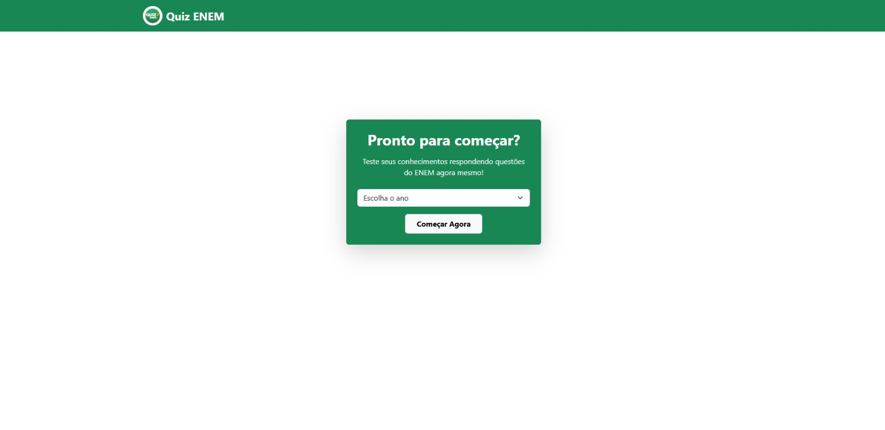
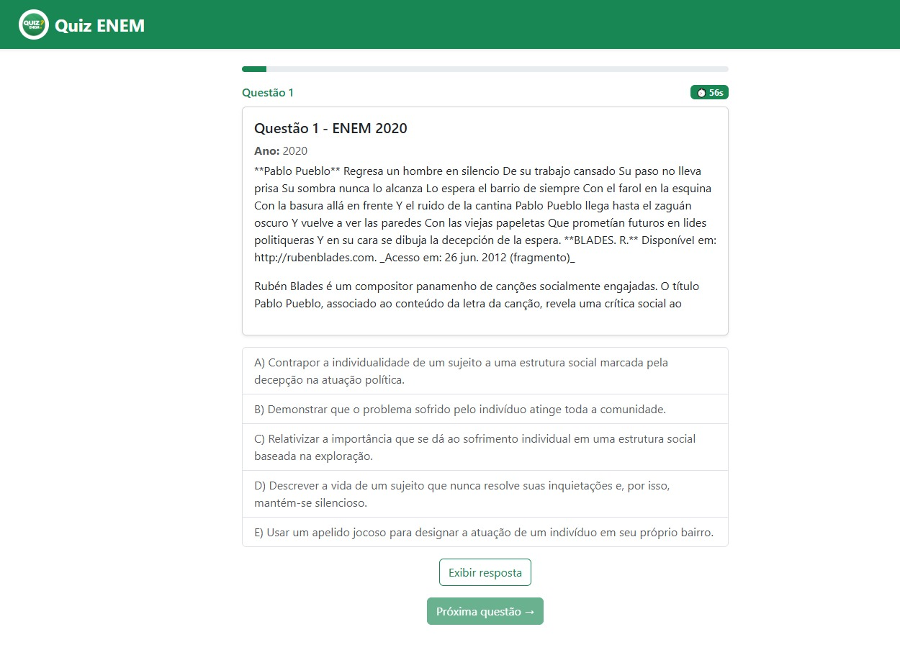

# 🎓 ENEM Quiz

Aplicação web interativa voltada à preparação de estudantes para o ENEM, desenvolvida com React.

## 📌 Sobre o projeto

O ENEM Quiz foi desenvolvido com o objetivo de proporcionar uma experiência de estudo interativa, utilizando tecnologias modernas de desenvolvimento front-end.

## 📸 Demonstração do projeto

### Página inicial



### Página de perguntas



## 🚀 Funcionalidades

- Interface responsiva e intuitiva.
- Sistema de questões para o ENEM.
- Navegação entre páginas.
- Confirmação de saída durante o questionário.
- Página personalizada de erro 404.

## 🛠️ Tecnologias utilizadas

- React
- JavaScript
- Vite
- React Router DOM
- PrimeReact
- PrimeFlex
- PrimeIcons
- CSS

## 💻 Como executar o projeto

Clone o repositório:

```bash
git clone https://github.com/KauaMouraa/Enem-quiz-with-React.git
```

Acesse a pasta do projeto:

```bash
cd Enem-quiz-with-React
```

Instale as dependências:

```bash
npm install
```

Execute a aplicação:

```bash
npm run dev
```

## 📚 Aprendizados

Durante o desenvolvimento deste projeto, aprimorei meus conhecimentos em:

- Desenvolvimento front-end.
- Componentização com React.
- Gerenciamento de rotas.
- Responsividade.
- Organização de código.
- Git e GitHub.

## 👨‍💻 Autor

Desenvolvido por Kauã Moura.

[LinkedIn](https://www.linkedin.com/in/kauam0ura/) |
[GitHub](https://github.com/KauaMouraa)
